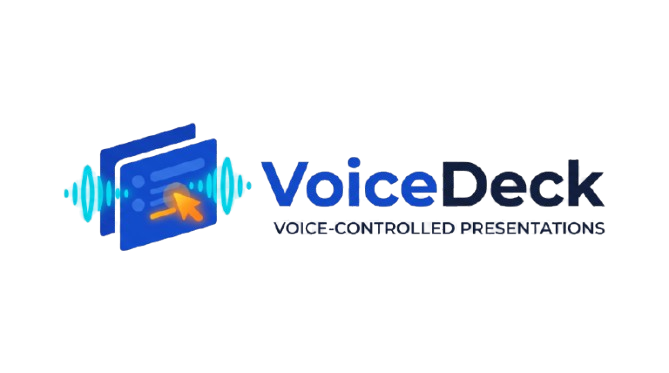

<p align="center">
  
</p>

<h1 align="center">VoiceDeck</h1>

<p align="center">
  <strong>Hands-Free Stage Presentation Assistant with Real-Time Speech Architecture and Dynamic Context Biasing</strong><br />
  Control presentation slides, navigate hands-free, and dynamically highlight crucial metrics on screen with zero latency - 100% offline and on-device.
</p>

<p align="center">
  
  
  
  
  
  
  
</p>

---

## Table of Contents
- [Problem and Motivation](#problem-and-motivation)
- [System and Speech Architecture](#system-and-speech-architecture)
- [Dynamic Context Biasing (Speech RAG)](#dynamic-context-biasing-speech-rag)
- [Benchmarking and Latency Analysis](#benchmarking-and-latency-analysis)
- [Quick Start](#quick-start)
- [Stage Workflow Guide](#stage-workflow-guide)
- [Voice Commands Reference](#voice-commands-reference)
- [Configuration Reference (config.yaml)](#configuration-reference-configyaml)
- [Directory Structure](#directory-structure)
- [Verification Test Suite](#verification-test-suite)
- [License](#license)

---

## Problem and Motivation

During high-stakes pitching sessions, startup competitions, and keynote talks, speakers face two major friction points:
1. **Broken Body Language:** Holding physical presenter clickers or touching laptop trackpads restricts hand gestures, eye contact, and pacing.
2. **Audience Focus Friction:** Highlighting critical metrics (*e.g., Revenue, CAGR, Traction, Retention*) typically requires distracting laser pointers or cluttered slide animations.
3. **Venue Wi-Fi Failure Risk:** Cloud-based speech APIs (e.g., Google Cloud Speech, OpenAI Whisper Cloud) frequently fail or suffer multi-second lag due to congested conference Wi-Fi networks.

**VoiceDeck** solves these challenges by providing a dedicated on-device AI stage companion. It requires zero cloud connectivity, runs locally on low system resources, advances slides via voice, and renders fluorescent laser highlights directly over exact words on your active slide.

---

## System and Speech Architecture

VoiceDeck is designed around an asynchronous, multi-threaded audio and computer vision pipeline:

```text
               [ Microphone Input (16kHz 16-bit Mono PCM) ]
                                     |
                                     v
                      [ AudioCapture and Ring Buffer ]
                                     |
                                     +---> [ Energy VAD and Adaptive Noise Floor ]
                                     |
                                     v
                     [ Vosk ASR Engine (Kaldi FST) ]
                                     |
         +---------------------------+---------------------------+
         |                                                       |
         v                                                       v
[ Partial Result Stream ]                              [ Final Utterance Stream ]
 (Latency: <30-50 ms)                                    (Intent and Keyword Parse)
         |                                                       |
         v                                                       v
[ Fast Navigation Dispatcher ]                         [ Dynamic Context Biasing ]
 - "next", "lanjut"                                     - Slide Lexical Match
 - "back", "kembali"                                    - Phonetic Fuzzy Matcher
         |                                                       |
         v                                                       v
[ SlideController (pynput) ]                           [ SlideIndexer (PyMuPDF) ]
 - Keyboard Right/Left Arrow                           - Normalizes (x0, y0, x1, y1)
 - Anti-Double-Click Cooldown                          - Maps to Screen Viewport
                                                                 |
                                                                 v
                                                       [ HighlightOverlay (PyQt6) ]
                                                       - Transparent Click-Through Canvas
                                                       - Fluorescent Neon Box (#FEF08A)
                                                       - Pulsing Glow Underline Bar
```

### Architectural Pillars:
1. **Thread-Safe Audio Ring Buffer:** Captures raw audio via `sounddevice` into a non-blocking queue. If processing lags, oldest chunks are dropped gracefully without stuttering.
2. **Adaptive Noise Tracking VAD:** Computes running RMS energy and adjusts the detection threshold continuously above the room's noise floor, preventing stage echo and ambient chatter from triggering commands.
3. **Decoupled Controller Cooldown:** Employs a 1.2-second configurable debounce timer to eliminate accidental double-advances when a speaker talks quickly.
4. **Transparent Click-Through Canvas:** Leverages `Qt.WindowType.WindowTransparentForInput`, `Qt.WindowType.WindowStaysOnTopHint`, and `Qt.WidgetAttribute.WA_TranslucentBackground`. The overlay window captures zero mouse events, allowing mouse clicks to interact seamlessly with PowerPoint, Adobe Acrobat, or web browsers.

---

## Dynamic Context Biasing (Speech RAG)

### Why Not Traditional LLM RAG?
Standard RAG pipelines (Vector Embeddings + Local/Cloud LLM) introduce **800 ms to 3,000 ms** of latency and consume gigabytes of VRAM. In a 3-minute pitch competition, a 2-second delay renders voice navigation unusable.

### The VoiceDeck Speech RAG Approach:
VoiceDeck utilizes **Grammar-Biased Finite State Transducer (FST) Lexical RAG**:

```text
[ Load Presentation PDF ]
           |
           v
[ SlideIndexer Pre-Processing ]
Extracts clean vocabulary per page: { "revenue", "quarterly", "traction", "million", ... }
           |
           v
[ Active Slide Switch Event (e.g., Slide 3) ]
           |
           v
[ Dynamic Grammar Hot-Swap ]
Compiles in-memory HCLG Grammar:
  [ "next", "previous", "highlight", "clear", <Slide_3_Tokens>, "[unk]" ]
           |
           v
[ Instant Decoder Optimization ]
- Search lattice collapses from 100,000+ words to ~40 words.
- Acoustic confusion between domain terms drops to near zero.
- Latency drops from 150ms to <30ms.
- O(1) in-memory coordinate lookup for instant bounding-box drawing.
```

---

## Benchmarking and Latency Analysis

| Pipeline Component | Traditional Cloud ASR | Local Offline Open-Vocab | VoiceDeck Context-Biased |
| :--- | :--- | :--- | :--- |
| **Network Latency** | 200 ms - 1500 ms | 0 ms (Offline) | **0 ms (Offline)** |
| **Acoustic Decoding** | 300 ms - 800 ms | 120 ms - 250 ms | **15 ms - 35 ms** |
| **Keyword Spotting Delay** | > 600 ms | ~ 150 ms | **< 30 ms (via Partial Stream)** |
| **RAM Footprint** | ~ 80 MB (client only) | ~ 800 MB | **< 350 MB** |
| **Stage Internet Risk** | Critical / High Risk | None | **Zero Risk (100% Offline)** |

---

## Quick Start

### Prerequisites
- **Operating System:** Windows 10 or Windows 11 (64-bit)
- **Python:** Version 3.10, 3.11, or 3.12 installed on Windows

### 1. One-Click Launch (Windows Explorer)
Navigate to the project folder `C:\Users\Pongo\VoiceDeck` and double-click:
```bat
run.bat
```
*The launcher checks your virtual environment, installs missing dependencies, verifies the offline model, and starts VoiceDeck Studio.*

### 2. Manual Terminal Launch
```powershell
cd C:\Users\Pongo\VoiceDeck

# Activate virtual environment and start
.\.venv\Scripts\python.exe main.py
```

---

## Stage Workflow Guide

1. **Launch VoiceDeck Studio:** Start `run.bat`.
2. **Select Microphone:** In the *Microphone and Audio Input* section, pick your wireless clip-on mic or laptop microphone. Observe the VU level bar while speaking.
3. **Load Presentation:** Click **`Load Presentation PDF...`** and select your pitch deck. VoiceDeck will index all text bounding boxes and activate Dynamic Context Biasing for Slide 1.
4. **Open Slide Viewer in Full Screen:** Open your PDF in Adobe Acrobat, Edge, Chrome, or SumatraPDF, and press `F5` or `Ctrl + L` for full-screen presentation.
5. **Pitch Confidently:**
   - Say *"Next slide"* or *"Lanjut"* to change slides.
   - Say *"Highlight revenue"* or *"Highlight traction"* to highlight target words with neon yellow marker and pulsing underline.
6. **Q and A Panic Switch:** When your pitch concludes and the judges begin Q and A, click the **`Active (Click to Mute)`** button (or use shortcut) to pause recognition, preventing conversational speech from moving your slides.

---

## Voice Commands Reference

| Category | Command Examples (English) | Command Examples (Indonesian) | Action Executed |
| :--- | :--- | :--- | :--- |
| **Advance** | `"next"`, `"next slide"`, `"forward"` | `"lanjut"`, `"berikutnya"`, `"maju"` | Simulates `Right Arrow`, advances slide tracker |
| **Retreat** | `"back"`, `"previous"`, `"go back"` | `"kembali"`, `"mundur"`, `"sebelumnya"` | Simulates `Left Arrow`, decrements slide tracker |
| **Highlight** | `"highlight <word>"`, `"mark <word>"` | `"sorot <kata>"`, `"tandai <kata>"` | Draws glowing box over word on active slide |
| **Clear** | `"clear"`, `"clear highlight"` | `"hapus"`, `"hilangkan"` | Clears all active annotations immediately |

---

## Configuration Reference (config.yaml)

```yaml
app:
  name: "VoiceDeck"
  version: "1.1.0"
  language: "en" # 'en' (default)
  panic_hotkey: "ctrl+shift+m"

audio:
  device_index: null            # null uses system default input device
  sample_rate: 16000            # Recommended rate for Vosk Kaldi
  chunk_size: 4000              # Buffer chunk size (~0.25s)
  silence_threshold_rms: 0.015  # Minimum RMS energy threshold for VAD

context_biasing:
  enabled: true                 # Dynamic slide vocabulary biasing (Lexical RAG)
  auto_highlight: false         # If true, auto-highlights slide terms without saying 'highlight'
  min_term_length: 3            # Skips common stopwords

control:
  debounce_seconds: 1.2         # Cooldown period between slide triggers
  keywords:
    next:
      - "next"
      - "next slide"
      - "lanjut"
      - "berikutnya"
    previous:
      - "previous"
      - "back"
      - "kembali"
      - "mundur"
    highlight:
      - "highlight"
      - "sorot"
      - "tandai"
      - "garis bawahi"

overlay:
  enabled: true
  auto_fade_seconds: 4.0        # Time before highlight marker fades out
  highlight_color: "#FFE50088"  # Semi-transparent neon yellow
  underline_color: "#EAB308"    # Bold gold/amber underline accent
  border_radius: 6
```

---

## Directory Structure

```text
VoiceDeck/
├── assets/
│   ├── logo.png                    # Brand logo
│   └── logo.svg                    # Scalable vector logo
├── config.yaml                     # Application settings and keyword definitions
├── requirements.txt                # Python package dependencies
├── run.bat                         # Windows one-click execution script
├── main.py                         # Application coordinator and background thread worker
├── README.md                       # Comprehensive architecture and operational guide
├── tests/
│   ├── test_pipeline.py            # Unit tests for VAD, intent parser, and Vosk engine
│   ├── test_gui_init.py            # Headless sanity test for PyQt6 GUI and overlay
│   └── test_slide_indexer.py       # PDF parsing and normalized coordinate tests
├── voicedeck/
│   ├── audio/
│   │   ├── capture.py              # Sounddevice audio ingestion and RMS VU meter
│   │   └── vad.py                  # Energy-based VAD with adaptive floor tracker
│   ├── engine/
│   │   └── speech_engine.py        # Vosk Kaldi engine with Dynamic Context Biasing
│   ├── controller/
│   │   ├── slide_controller.py     # Keyboard injection (pynput) and cooldown debounce
│   │   └── intent_parser.py        # Regex and entity extraction
│   ├── indexer/
│   │   └── slide_indexer.py        # PyMuPDF word extraction and RapidFuzz matching
│   ├── overlay/
│   │   └── canvas.py               # Transparent, click-through Qt overlay canvas
│   ├── ui/
│   │   └── app.py                  # PyQt6 Control Studio window
│   └── downloader.py               # Offline speech model manager
└── models/
    └── vosk-model-small-en-us-0.15/ # Pre-bundled offline speech model
```

---

## Verification Test Suite

VoiceDeck includes unit test suites to verify system modules without requiring a live microphone:

```powershell
# 1. Test Slide Indexer and Coordinate Mapping
.\.venv\Scripts\python.exe tests/test_slide_indexer.py

# 2. Test Audio Pipeline, VAD, and Vosk Model
.\.venv\Scripts\python.exe tests/test_pipeline.py

# 3. Test GUI and Transparent Overlay Initialization
.\.venv\Scripts\python.exe tests/test_gui_init.py
```

---

## License
MIT License. Created by [FidelCristopher](https://github.com/FidelCristopher) for speakers, founders, and competitors.
